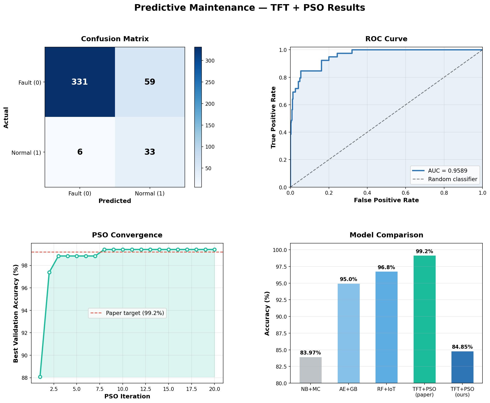

# Predictive Maintenance with TFT + PSO + MLOps

An implementation of the research paper:

> **Aiswarya RS** (2024). *"Smart Manufacturing with MLOps: A Model Management and Automation Framework for Predictive Maintenance."* Volume 20, Issue 1, March 2024, pp. 20–31. ISSN 1300-669.

The paper proposes a predictive maintenance framework for hydraulic systems built from five parts. This repo implements each one:

1. **Preprocessing:** interpolation, z-score normalization, rolling windows (paper §3.2)
2. **Temporal Fusion Transformer (TFT)** that predicts equipment faults (§3.3)
3. **Particle Swarm Optimization (PSO)** that tunes the TFT's hyperparameters (§3.3)
4. **MLOps:** experiment tracking, deployment, **CUSUM drift detection** and automated retraining (§3.3)
5. **SRE + Chaos Engineering:** exponential backoff, SLO tracking, rollback, fault injection (§3.3)

---

## Paper → code map

| Paper | Equation | File |
|---|---|---|
| Linear interpolation of missing values | Eq. 1 | `preprocessing/preprocess.py` → `interpolate_missing` |
| Z-score normalization | Eq. 2 | `preprocessing/preprocess.py` → `zscore_normalize` |
| Rolling windows + labels from machine state | — | `preprocessing/preprocess.py` → `create_sequences` |
| TFT attention `Softmax(QKᵀ/√dₖ)V` | Eq. 3 | `model/tft.py` |
| TFT forecast `ŷₜ = TFT(x₁:ₜ)` | Eq. 5 | `model/tft.py` |
| PSO velocity update (tunes learning rate, number of layers, attention heads) | Eq. 4 | `model/pso.py` |
| MLOps pipeline: training, tracking, deployment | — | `mlops/pipeline.py` (MLflow) |
| CUSUM drift detection `Sₜ = max(0, Sₜ₋₁ + (yₜ − μ) − δ)` | Eq. 6 | `mlops/drift.py` |
| Automated retraining on drift + model rollback | — | `mlops/retrain.py`, `mlops/registry.py` |
| Exponential backoff `initial_delay × 2^retry` | Eq. 7 | `resilience/backoff.py` |
| SLOs / SLIs, service availability | Eq. 14 | `resilience/sre.py` |
| Chaos engineering: lost sensor readings, warped time series | — | `resilience/chaos/` |
| Accuracy, Precision, Recall, F1, RMSE, MAE, AUC-ROC | Eq. 8–13 | `evaluation/metrics.py` |
| Throughput and latency (scalable efficiency) | Eq. 15–16 | `evaluation/metrics.py`, `mlops/pipeline.py` |
| Comparison with NB+MC, AE+GB, RF+IoT (paper Figure 3) | — | `evaluation/visualize.py` |

---

## How it works end to end

```
data/download_data.py      UCI Hydraulic dataset → 2205 cycles × 68 features
        │
preprocessing/preprocess   Eq.1 interpolate → Eq.2 z-score → 60-cycle windows
        │                  → time-ordered 80/20 split (no shuffling)
        ▼
model/pso.py               Eq.4 PSO: 10 particles × 20 iterations
        │                  each particle = (learning rate, #layers, #heads)
        │                  fitness = validation error of a 5-epoch TFT
        ▼
mlops/pipeline.py          train final TFT with best params (Eq.7 backoff on failure)
        │                  evaluate Eq.8-13, measure Eq.15-16, log to MLflow,
        │                  save production checkpoint
        ▼
mlops/drift.py             Eq.6 CUSUM on (actual − predicted probability)
        │  drift?
        ▼
mlops/retrain.py           back up current model → retrain → if not better: rollback
        │
api.py                     deployed model: /predict, /health, /stats (Eq.14-16)
resilience/chaos/          inject sensor dropout / noise / latency, check recovery, report SLO
```

### 1. Data (`data/download_data.py`)
[UCI Condition Monitoring of Hydraulic Systems](https://archive.ics.uci.edu/dataset/447/condition+monitoring+of+hydraulic+systems): 17 sensors (pressure, flow, temperature, vibration, motor power, efficiency) over 2205 load cycles. The sensors sample at different rates (1 Hz to 100 Hz), so each cycle is summarised per sensor as mean, std, min and max. That gives 17 × 4 = **68 features**.

The target is `stable_flag` from `profile.txt`: **1 = normal, 0 = fault/unstable**.

### 2. Preprocessing (`preprocessing/preprocess.py`)
- **Eq. 1:** linear interpolation fills missing sensor values.
- **Eq. 2:** z-score normalization puts every sensor on the same scale.
- **Rolling windows:** each sample is the last 60 cycles (60 × 68), and its label is the machine state at the next cycle.
- **Temporal split:** the first 80% is train and the last 20% is test, with no shuffling, because the model must not see the future.

### 3. TFT (`model/tft.py`)
A compact Temporal Fusion Transformer for classification:

```
input (60 × 68) → linear projection → Gated Residual Network (variable selection)
→ LSTM encoder (local temporal patterns)
→ multi-head self-attention, Eq. 3 (long-range dependencies)
→ residual + LayerNorm → GRN → last timestep (Eq. 5) → classifier → fault / normal
```
A **Gated Residual Network** learns a gate `g` and outputs `norm(g · transformed + (1 − g) · skip)`, so the network can skip a block it doesn't need.

### 4. PSO (`model/pso.py`)
Each particle is a point in the hyperparameter space the paper names: **learning rate, number of LSTM layers, number of attention heads**. Hidden size and dropout are fixed in `config.yaml`. Every iteration:
1. Each particle trains a small TFT for 5 epochs. Its fitness is the validation error.
2. Each particle tracks its personal best (`pbest`), and the swarm tracks a global best (`gbest`).
3. Velocity is updated with **Eq. 4**: `v = w·v + c1·r1·(pbest − x) + c2·r2·(gbest − x)`, with `w = 0.7` and `c1 = c2 = 1.5`.

Discrete hyperparameters are rounded: layers to {1, 2, 3}, and heads to {1, 2, 4, 8}, which all divide the hidden size. The best accuracy per iteration is saved to `data/processed/pso_history.json` for the convergence plot.

### 5. MLOps (`mlops/`)
- **Tracking:** every run logs its parameters, metrics and model to MLflow (`mlflow ui`).
- **Deployment:** the best model is saved as the production checkpoint, together with its hyperparameters (`best_params.json`). The API serves exactly this model.
- **Drift detection (Eq. 6):** CUSUM accumulates `(actual − predicted)` minus a slack `δ = 0.5`. A drift point is raised when the sum exceeds the threshold (5.0). Three or more drift points trigger retraining.
- **Automated retraining:** back up the current model, retrain, and compare accuracy. If the new model is worse, `rollback_model()` restores the previous one.

### 6. SRE + Chaos Engineering (`resilience/`)
- **Exponential backoff (Eq. 7):** training and model loading are retried after 1s, 2s, 4s, and so on.
- **SRE monitor:** tracks uptime and downtime, computes **availability (Eq. 14)**, and checks it against the paper's **97.3% SLO**.
- **Chaos suite** (`python resilience/chaos/run_chaos.py`). It checks the steady state, then runs three experiments:
  1. drop pressure sensor PS1 (lost sensor readings)
  2. inject Gaussian noise into 30% of the windows (warped time series)
  3. add 2s of latency

  Then it rolls back and checks that the system still predicts. `experiment.json` defines the same experiment in Chaos Toolkit format.
- **Self-healing:** if the API cannot load the production model, it rolls back to the last good one.

---

## Running it

```bash
pip install -r requirements.txt
python data/download_data.py        # download + build sensors.csv / labels.csv
python main.py                      # preprocessing → PSO → training → evaluation → drift check
python main.py --skip-pso           # same, using config.yaml defaults (fast)

python evaluation/visualize.py      # confusion matrix, ROC, PSO convergence, comparison
python resilience/chaos/run_chaos.py
mlflow ui                           # browse runs at http://localhost:5000
python api.py                       # serve the model at http://localhost:8000/docs
```

With Docker: `docker compose up` starts the API and an MLflow server.

CI (`.github/workflows/ci.yml`) tests each paper component (Eq. 1–2, 3–5, 4, 6, 7) and builds the Docker image on every push.

---

## Results

PSO: 10 particles × 20 iterations. The best validation accuracy was **99.42%**, reached at iteration 8, with 8 attention heads, 2 LSTM layers and learning rate 0.00234.

Final TFT, measured on the held-out last 20% of cycles (429 windows):

| Metric | Ours | Paper |
|---|---|---|
| Accuracy | 84.85% | 99.2% |
| Precision | 92.55% | 97.5% |
| Recall | 84.85% | 98.4% |
| F1-Score | 87.36% | 96.5% |
| AUC-ROC | 0.9589 | 0.987 |
| RMSE / MAE | 0.389 / 0.152 | — |
| Throughput | 637 samples/s (CPU) | — |
| Latency | 14.5 ms/request (CPU) | — |

Run `python evaluation/visualize.py` for the plots and `python resilience/chaos/run_chaos.py` for the availability and robustness numbers. The metrics are saved to `data/processed/metrics.json`.



### Why test accuracy is lower than PSO validation accuracy
The split is strictly **chronological** (no future data in training), and the hydraulic rig's conditions change over the course of the recording, so each split has a very different class mix:

| Split | Windows | Fault % |
|---|---|---|
| Train | 1372 | 67.6% |
| PSO validation | 344 | 38.1% |
| Test | 429 | 90.9% |

PSO is evaluated on a mostly-*normal* period, and the model is tested on an almost-all-*fault* period. On such a skewed test set, small shifts in the decision threshold move accuracy a lot. AUC-ROC measures how well the model separates the classes at *every* threshold, and it stays around 0.96, so the model still ranks faults well.

Before a random seed was added, the same configuration scored anywhere from 82% to 97% across runs (see MLflow history). The paper does not describe its split, so its 99.2% is not directly comparable. A random split would leak future data and inflate the score.

---

## Implementation notes

Places where the paper leaves details open, and what we chose:
- **Classification target:** the paper says "predict equipment failures". We use the dataset's `stable_flag` as a binary fault/normal label.
- **RMSE / MAE (Eq. 12–13):** computed on the predicted vs. actual class labels, since the task is classification.
- **CUSUM inputs:** `yₜ` is the true label and `μ` is the model's predicted probability of "normal", so a growing gap between reality and predictions signals drift.

---

## Project structure

```
├── data/download_data.py        # dataset download + feature aggregation
├── preprocessing/preprocess.py  # Eq. 1-2, rolling windows, temporal split
├── model/
│   ├── tft.py                   # Temporal Fusion Transformer (Eq. 3, 5)
│   └── pso.py                   # Particle Swarm Optimization (Eq. 4)
├── mlops/
│   ├── pipeline.py              # train / evaluate / MLflow / deploy
│   ├── drift.py                 # CUSUM (Eq. 6)
│   ├── retrain.py               # automated retraining on drift
│   └── registry.py              # checkpoint, backup, rollback
├── resilience/
│   ├── backoff.py               # exponential backoff (Eq. 7)
│   ├── sre.py                   # SLO / availability monitor (Eq. 14)
│   └── chaos/                   # fault injection experiments
├── evaluation/
│   ├── metrics.py               # Eq. 8-16
│   └── visualize.py             # result plots
├── api.py                       # FastAPI serving + Eq. 14-16 stats
├── main.py                      # runs the whole pipeline
├── config.yaml                  # all hyperparameters
├── Dockerfile, docker-compose.yml
└── .github/workflows/ci.yml
```
